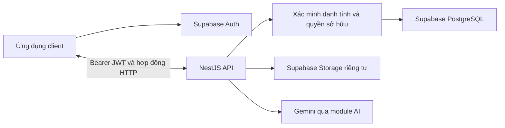
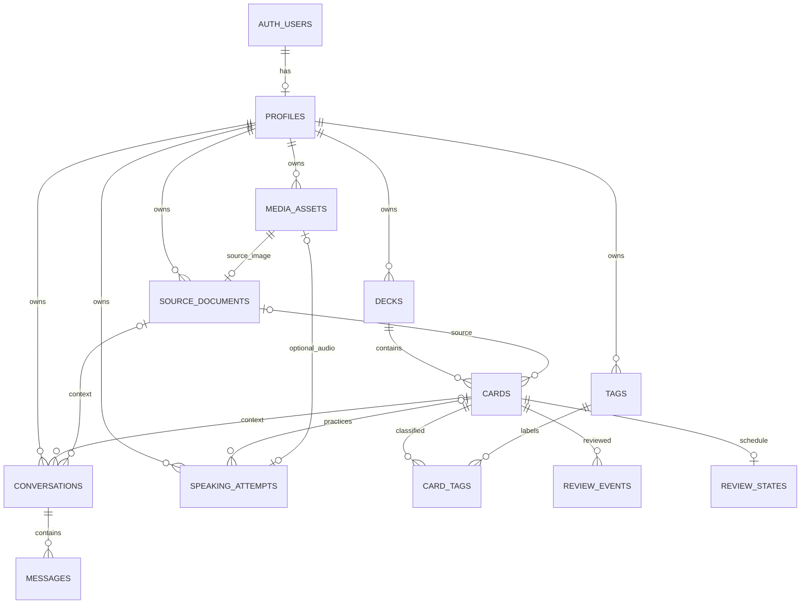

# CAM-02 — Kiến trúc và ERD logic

Trạng thái: **đề xuất để review**, chưa phải schema đã triển khai. Đọc [yêu cầu](data-requirements.md) trước. File này không chứa migration thực thi.

Cập nhật: một phần ERD đã triển khai trong [schema cốt lõi](database-core.md), có ghi rõ khác biệt và bảng/cột chưa triển khai. ERD dưới đây vẫn mô tả hướng thiết kế đầy đủ.

## 1. Kiến trúc đề xuất



Phạm vi Cảm bàn giao gồm API, xác minh danh tính, database và hợp đồng dữ liệu. Từ 19/11 bổ sung [tầng dữ liệu client CAM-08/09/10](cam-08-10-offline.md); không xây màn hình. Kiến trúc dưới đây mô tả hệ thống và server; xem tài liệu offline cho schema SQLite riêng.

Các module NestJS đề xuất: `auth`, `profiles`, `media`, `documents`, `decks`, `cards`, `reviews`, `sync`, `conversations`, `speaking`. Module AI/prompt do Nguyên phối hợp triển khai; Cảm phụ trách hợp đồng và lưu trữ. Tên endpoint vẫn giữ `/api/v1/vocabulary` theo issue nếu nhóm không quyết định đổi; bảng `cards` thể hiện mỗi bản ghi là một thẻ theo ngữ cảnh.

## 2. ERD nghiệp vụ



Quan hệ chủ sở hữu của các bảng con được lược bớt trong hình cho dễ đọc: chúng vẫn bắt buộc có `user_id`. `AUTH_USERS` là thực thể do Supabase Auth quản lý, không tạo lại. Hồ sơ có thể chưa tồn tại ngay sau đăng ký; backend phải tạo hồ sơ theo thao tác idempotent trước khi cho tạo dữ liệu học.

## 3. Quy ước dữ liệu chung

- Bảng nghiệp vụ dùng `id uuid` PK do client tạo khi dữ liệu có thể sinh offline; `profiles` dùng `user_id uuid` làm PK/FK tới Auth. `review_states` dùng `card_id uuid` làm PK.
- Mọi bảng nghiệp vụ có `user_id uuid NOT NULL`, `created_at timestamptz NOT NULL`, `updated_at timestamptz NOT NULL`, `version bigint NOT NULL` (khởi tạo 1, tăng trên server), `deleted_at timestamptz NULL`.
- Thời gian ghi nhận server do server đặt; thời điểm hành vi trên client có cột riêng. API dùng thời gian ISO 8601 UTC.
- Trong bảng bên dưới, cột không có `?` là NOT NULL; `?` là nullable. Chuỗi bắt buộc phải được trim và không rỗng; giới hạn độ dài cụ thể sẽ đưa vào CAM-04/migration.
- Trừ `profiles`, thêm UNIQUE `(user_id, id)` ở bảng cha để bảng con tham chiếu FK tổng hợp. Với review state dùng UNIQUE `(user_id, card_id)`.
- FK `(user_id, deck_id) -> decks(user_id, id)` ngăn thẻ A nối tới bộ B. Áp dụng tương tự cho mọi FK nghiệp vụ, kể cả FK nullable; kiểm tra quyền vẫn thực hiện ở API.
- Không lưu mật khẩu, refresh token hoặc Gemini key trong các bảng nghiệp vụ hoặc response API.

## 4. Từ điển dữ liệu logic

Các cột chung ở mục 3 được áp dụng mặc định, không lặp lại ở mỗi dòng.

| Bảng | Thuộc tính riêng | Khóa/ràng buộc và ý nghĩa |
| --- | --- | --- |
| `profiles` | `display_name text?`, `timezone text` | PK `user_id`; timezone là tên múi giờ hợp lệ, đề xuất mặc định UTC đến khi người dùng chọn |
| `media_assets` | `kind text`, `object_path text?`, `mime_type text`, `size_bytes bigint`, `width int?`, `height int?`, `checksum text?`, `status text` | kind image/audio; size >=0, kích thước nếu có >0; object_path UNIQUE khi có; status pending/ready/failed; ready bắt buộc có object_path |
| `source_documents` | `media_id uuid`, `ocr_original_text text`, `corrected_text text?`, `tokens jsonb`, `language text?`, `ocr_engine text` | FK media cùng owner; UNIQUE `(user_id, media_id)` theo giả định một ảnh/một tài liệu; media phải là image |
| `decks` | `name text`, `description text?` | Không bắt buộc tên bộ duy nhất; định danh theo UUID |
| `cards` | `deck_id uuid`, `source_document_id uuid?`, `source_token_id uuid?`, `word text`, `meaning text`, `phonetic text?`, `source_sentence text?`, `ai_example text?`, `is_favorite boolean` | FK bộ/tài liệu cùng owner; favorite mặc định false; không UNIQUE word; source_token_id cần có tài liệu và khớp token trong JSON |
| `review_events` | `card_id uuid`, `rating text`, `reviewed_at timestamptz`, `received_at timestamptz`, `timezone_at_review text`, `algorithm_version text` | FK thẻ cùng owner; ID sự kiện chống lặp; rating theo bảng ánh xạ sẽ chốt; nội dung sự kiện bất biến sau ghi nhận |
| `review_states` | `card_id uuid`, `due_at timestamptz`, `last_reviewed_at timestamptz?`, `algorithm_version text`, `state jsonb` | PK card_id và FK cùng owner; state chỉ chứa tham số theo schema thuật toán đã chốt, không phải JSON tùy ý; server tính lại từ events |
| `conversations` | `title text?`, `topic text`, `learner_role text`, `ai_role text`, `context_snapshot text`, `card_id uuid?`, `source_document_id uuid?` | FK nguồn cùng owner; snapshot giữ lịch sử độc lập với thay đổi nguồn |
| `messages` | `conversation_id uuid`, `request_id uuid`, `role text`, `content text`, `status text`, `sequence bigint` | role user/assistant; status pending/streaming/completed/failed/cancelled; UNIQUE `(user_id, request_id, role)`; UNIQUE `(conversation_id, sequence)`; cho phép content rỗng khi chưa hoàn tất |
| `speaking_attempts` | `card_id uuid?`, `audio_media_id uuid?`, `reference_text text`, `transcript text`, `alignment jsonb`, `text_match_score numeric?`, `scoring_version text`, `practiced_at timestamptz` | FK cùng owner; audio nếu có phải kind audio; đề xuất score 0..100, chờ Nguyên chốt; alignment có expected/recognized/status theo từng từ |

JSON cần schema rõ ràng trong CAM-04: validation không chỉ dừng ở JSON hợp lệ. Những quy tắc như kiểm tra media kind hoặc token trong JSON cần service/trigger phù hợp; FK đơn thuần không đảm bảo chúng.

### Dữ liệu OCR mẫu (minh họa, chưa là API contract)

```json
{
  "coordinate_space": "processed_image_pixels",
  "image_width": 1200,
  "image_height": 1600,
  "tokens": [
    {
      "id": "bf885260-e3e9-4e67-9811-be3622819e39",
      "original_text": "book",
      "corrected_text": null,
      "polygon": [[100, 200], [180, 200], [180, 230], [100, 230]],
      "confidence": null,
      "sentence": "This is a book."
    }
  ]
}
```

Polygon phải nằm trong kích thước ảnh đã xử lý; client cần biết scale/crop khi vẽ. Token ID giữ ổn định khi sửa chữ; thay engine/chạy OCR lại tạo revision mới hoặc phải cập nhật tham chiếu có kiểm soát. Thẻ giữ snapshot câu gốc nên không phụ thuộc token còn tồn tại mãi.

## 5. Index và chính sách xóa đề xuất

| Truy vấn | Index dự kiến | Lưu ý nghiệm thu |
| --- | --- | --- |
| Danh sách bộ/thẻ | `(user_id, updated_at, id)`; cards thêm `(user_id, deck_id, updated_at, id)` | Partial index `deleted_at IS NULL` cho danh sách đang dùng; phân trang có tie-break ID |
| Ôn đến hạn | review_states `(user_id, due_at, card_id)` | Lọc thẻ và bộ chưa xóa |
| Lịch sử/thống kê | review_events `(user_id, reviewed_at, id)` và `(user_id, card_id, reviewed_at)` | Chốt quy tắc ngày học trước khi tối ưu streak |
| Tin nhắn | UNIQUE `(conversation_id, sequence)` | Cursor theo sequence trong phiên của đúng owner |
| Tìm từ/nghĩa | Bắt đầu prefix normalized word; cân nhắc index text theo yêu cầu tìm chứa chuỗi | B-tree không mặc nhiên tối ưu `%keyword%`; benchmark trước khi thêm extension |
| Sync | change log `(user_id, sequence)` | Bao gồm cả tombstone; không dùng partial index bỏ dữ liệu đã xóa |

FK vật lý mặc định RESTRICT để tránh hard-delete lan truyền ngoài ý muốn. Soft-delete phải chạy bằng service transaction: xóa deck kéo theo cards; thẻ bị xóa không còn trong lịch ôn nhưng lịch sử được giữ cho đến chính sách purge. Xóa conversation soft-delete messages. Xóa document giữ snapshot trong cards. Media cleanup và xóa tài khoản cần workflow riêng vì Storage và Postgres không cùng một transaction.

Không đặt CASCADE từ Auth đến toàn bộ dữ liệu rồi coi việc xóa file đã được giải quyết. Trước triển khai xóa tài khoản cần danh sách object cần dọn, retry và kiểm chứng không còn dữ liệu truy cập được.

## 6. Hợp đồng đồng bộ và dữ liệu kỹ thuật server

Client tự quản lý lưu trữ, thao tác chưa ACK và cursor trong phần triển khai của mình. Backend quy định UUID/version/receipt, quyền theo owner và thứ tự commit để client đồng bộ an toàn; không phụ thuộc một SDK hoặc database client cụ thể.

### Dữ liệu kỹ thuật server

- `sync_receipts`: PK `(user_id, operation_id)`, request_hash, result JSON, processed_at. Cùng ID nhưng payload khác phải bị từ chối; kết quả và thay đổi nghiệp vụ commit cùng transaction.
- `sync_heads`: PK user_id, last_sequence bigint. Đề xuất khóa một hàng theo user trong transaction ghi; cấp sequence dưới khóa để một sync reader không nhảy qua một transaction chưa commit.
- `sync_changes`: PK `(user_id, sequence)`, entity_type, entity_id, entity_version, action, snapshot JSON, changed_at. Ghi thay đổi/tombstone cùng transaction với nghiệp vụ, kể cả ghi từ endpoint thường và module AI.

Không dùng sequence tự tăng toàn cục một cách ngây thơ rồi coi thứ tự cấp số là thứ tự commit. Chọn cơ chế cursor đáng tin cậy là điều kiện nghiệm thu CAM-09. Thiết kế khóa theo user ở trên là đề xuất đơn giản cho quy mô đồ án, cần đo contention.

### Chu trình đề xuất

1. Client gửi UUID ổn định và payload theo hợp đồng; request phải có Bearer token đúng owner.
2. Quan hệ phụ thuộc được kiểm tra trên server: bộ phải tồn tại trước thẻ, thẻ phải tồn tại trước lượt ôn.
3. Server xác minh token/owner, kiểm tra receipt và base_version. Theo CAM-09 hiện tại, batch mới áp dụng all-or-nothing; nếu có conflict thì rollback cả batch mới và trả thông tin để xử lý, không báo thành công một phần.
4. Ghi business data, receipt và change log trong cùng transaction. Retry batch đã thành công trả lại kết quả đã lưu, không lặp side effect. Chi tiết trộn receipt cũ và thao tác mới phải được quy định trong CAM-04.
5. ACK chứa đúng operation_id/entity/version; client chịu trách nhiệm bảo toàn các chỉnh sửa chưa gửi trong phần triển khai của mình.
6. Client tải delta theo cursor và giới hạn trang; server chụp high-water mark cho đợt tải. Client áp dụng trang + cursor cùng transaction; thay đổi remote trùng entity đang dirty phải được phân giải, không ghi đè local âm thầm.
7. Retry lỗi mạng theo backoff+jitter; lỗi validation/permission không retry vô hạn. Token hết hiệu lực dừng batch để xử lý Auth. Sau đổi tài khoản, callback của phiên sync cũ không được ghi vào DB mới.

Conflict đề xuất: UPDATE dùng base_version; sai version trả conflict với trạng thái server và giữ bản local cho lựa chọn giữ server/tạo chỉnh sửa mới. DELETE-vs-UPDATE trả tombstone, không tự hồi sinh. CREATE retry nhận receipt hoặc so sánh định danh; không cho client chiếm ID của người khác. Review events gộp theo event ID, sau đó tái tính state theo chính sách thứ tự đã chốt.

Các endpoint đề xuất để CAM-04 đặc tả: `POST /api/v1/sync/batch`, `GET /api/v1/sync/changes?cursor=...&limit=...`; cần full snapshot/resync khi cursor hết hạn. Cơ chế resync phải giữ lại outbox chưa ACK và xử lý lại xung đột sau snapshot.

Media upload có trạng thái pending/ready/failed; không giả vờ có transaction chung giữa Storage và DB. Dùng object key ổn định, xác nhận upload và retry; bản ghi có thể đồng bộ metadata pending trước, UI hiển thị chờ ảnh. URL truy cập tạm thời không lưu làm nguồn chuẩn: giữ object_path và yêu cầu quyền truy cập khi cần.

## 7. Giới hạn và bước tiếp theo

Đây là ERD logic, chưa khóa ORM, cấu trúc JSON thuật toán, enum rating, hạn dữ liệu hoặc chính sách Web. Chưa có SQL migration, RLS policy thực thi, contract OpenAPI, unit/integration test hoặc số đo hiệu năng. Các mục đó thuộc giai đoạn tiếp theo, không thể đánh dấu CAM-02 hoàn thành chỉ bằng sơ đồ.
