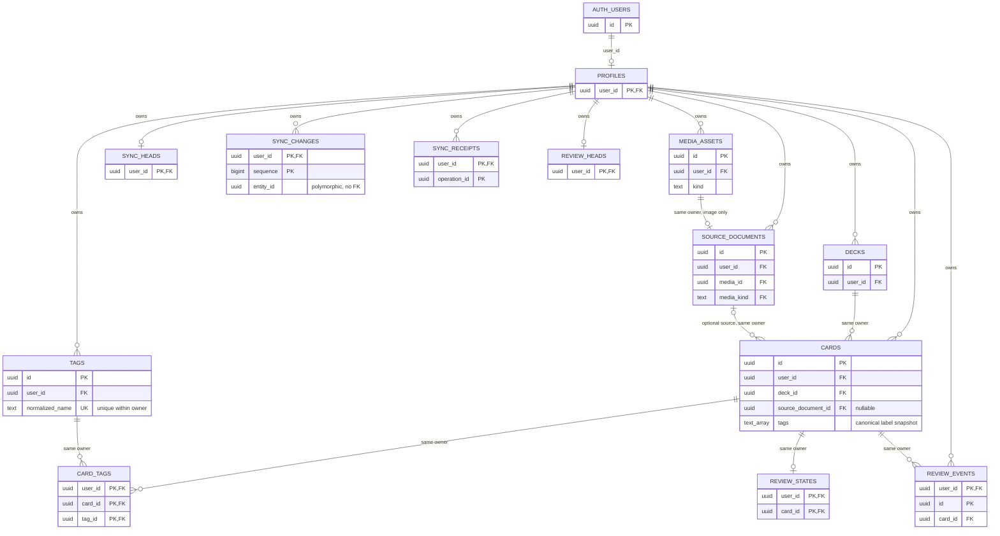

# CAM-02 — Từ điển database đã triển khai

Cập nhật 18/11/2026. Nguồn chuẩn: [migrations 001–007](../../app/backend/database/migrations/). Có **13 bảng trong schema app**; auth.users thuộc Supabase, app_migrations.history là ledger vận hành. [ERD logic](architecture-erd.md) mô tả cả thực thể dự kiến; ERD sau chỉ thể hiện bảng hiện có.

## Quy ước và metadata chung

Dấu ? nghĩa là nullable; cột khác đều NOT NULL trừ generated column có nêu riêng. Default — nghĩa là không có SQL default: bên ghi phải cung cấp, trừ cột do trigger gán. UUID do client cấp cho deck/card; tags.id mặc định gen_random_uuid(). CHECK độ dài không tự trim nội dung; riêng tag có trigger chuẩn hóa.

Năm bảng mutable profiles, decks, media_assets, source_documents, cards có:

| Cột | Kiểu / default | Ý nghĩa và ràng buộc |
| --- | --- | --- |
| user_id | uuid / — | Owner, FK profiles; riêng profiles là PK/FK auth.users |
| created_at | timestamptz / clock_timestamp() | Trigger đặt giờ server khi INSERT, giữ nguyên khi UPDATE |
| updated_at | timestamptz / clock_timestamp() | Trigger đặt giờ server mỗi lần ghi |
| version | bigint / 1 | CHECK >0; trigger ép INSERT=1, UPDATE=OLD+1; API trả chuỗi |
| deleted_at? | timestamptz / NULL | Tombstone; không cấp DELETE cho runtime |

Bốn bảng ngoài profiles có id UUID PRIMARY KEY và UNIQUE(user_id,id). Trigger stamp_record chặn đổi id/owner, bỏ qua timestamp/version tự gửi. Các bảng sync/review **không** có bộ metadata trên.

## Profiles, decks, media, nguồn OCR và cards

| Bảng | Cột riêng | Kiểu / default | Ràng buộc và ý nghĩa |
| --- | --- | --- | --- |
| profiles | user_id | uuid / — | PK; FK auth.users(id) |
| profiles | display_name? | text / NULL | Trim dài 1–120 |
| profiles | timezone | text / 'UTC' | Trigger kiểm tra pg_timezone_names |
| decks | id | uuid / — | PK; UNIQUE(user_id,id) |
| decks | name | text / — | Trim 1–200; cho phép trùng |
| decks | description? | text / NULL | <=4000 ký tự |
| media_assets | id | uuid / — | PK; UNIQUE(user_id,id), UNIQUE(user_id,id,kind) |
| media_assets | kind | text / — | image hoặc audio |
| media_assets | object_path? | text / NULL | UNIQUE toàn bảng, trim 1–1024; bắt buộc khi ready |
| media_assets | mime_type | text / — | Trim 1–100; DB không kiểm tra bytes file |
| media_assets | size_bytes | bigint / — | >=0 |
| media_assets | width?, height? | integer / NULL | >0 khi có; image bắt buộc cả hai |
| media_assets | checksum? | text / NULL | <=128 |
| media_assets | status | text / 'pending' | pending, ready, failed |
| source_documents | id | uuid / — | PK; UNIQUE(user_id,id) |
| source_documents | media_id | uuid / — | UNIQUE(user_id,media_id): mỗi media tối đa một document |
| source_documents | media_kind | text / 'image' | CHECK=image; FK composite xác nhận owner và kind |
| source_documents | ocr_original_text | text / — | Bản OCR gốc, cho phép rỗng |
| source_documents | corrected_text? | text / NULL | Bản sửa độc lập bản gốc |
| source_documents | tokens | jsonb / [] | CHECK jsonb_typeof='array'; chưa CHECK từng token/bbox |
| source_documents | language? | text / NULL | <=35 |
| source_documents | ocr_engine | text / — | Trim 1–100 |
| cards | id | uuid / — | PK; UNIQUE(user_id,id) |
| cards | deck_id | uuid / — | FK cùng owner tới deck |
| cards | source_document_id? | uuid / NULL | FK cùng owner tới nguồn; tùy chọn |
| cards | word | text / — | Trim 1–300; cho phép trùng theo ngữ cảnh |
| cards | meaning | text / — | Trim 1–4000 |
| cards | phonetic? | text / NULL | <=300 |
| cards | source_sentence?, ai_example? | text / NULL | <=10000 mỗi cột; snapshot câu gốc độc lập bản sửa OCR |
| cards | is_favorite | boolean / false | Đánh dấu yêu thích |
| cards | tags | text[] / {} | 0–20 tên chuẩn, mỗi tên 1–50 code points; trigger trim/NFC, kiểm tra trùng và dựng membership |

Tag đã có registry/junction ở migration 007; chưa có source_token_id. Bảng metadata media/OCR đã có. [CAM-13](cam-13-ocr.md) đã triển khai OCR stateless: trả kết quả, không lưu ảnh hoặc ghi media_assets/source_documents; upload/lưu nguồn riêng chưa triển khai. Không thêm migration cho OCR.

## Registry tag và quan hệ thẻ–tag

| Bảng | Cột | Kiểu / default | Ràng buộc và ý nghĩa |
| --- | --- | --- | --- |
| tags | id | uuid / gen_random_uuid() | PK; UUID server sinh; UNIQUE(user_id,id) |
| tags | user_id | uuid / — | FK profiles ON DELETE RESTRICT |
| tags | name | text / — | =normalize(btrim(name),NFC), dài 1–50; cách viết đầu tiên của owner |
| tags | normalized_name | text GENERATED ALWAYS AS lower(name) STORED | Không có NOT NULL khai báo riêng; name NOT NULL nên giá trị sinh không null; UNIQUE(user_id,normalized_name) |
| tags | created_at | timestamptz / clock_timestamp() | Giờ đăng ký nhãn |
| card_tags | user_id, card_id, tag_id | uuid / — | PK cả ba; hai FK composite tới card/tag cùng owner |
| card_tags | created_at | timestamptz / clock_timestamp() | Giờ tạo link; thay membership có thể tạo lại link |

Hai bảng này không có metadata mutable/version riêng. Runtime chỉ SELECT theo owner. normalize_card_tags BEFORE INSERT/UPDATE OF tags trên card lấy advisory lock owner, chuẩn hóa/tra registry và viết lại cards.tags theo tên chuẩn. attach_card_tags AFTER thay các link trong cùng transaction. Hai hàm SECURITY DEFINER private, search_path=pg_catalog, không EXECUTE PUBLIC.

cards.tags là snapshot API/sync, card_tags là quan hệ được trigger dựng để tra cứu bằng index; không cho runtime tự sửa registry/link. Xóa mềm giữ link; thay/gỡ tags tăng đúng một version card. Chi tiết contract, giới hạn và kiểm thử ở [CAM-05 tags](cam-05-tags.md).

## Sync: head, delta, receipt

| Bảng | Cột | Kiểu / default | Ràng buộc và ý nghĩa |
| --- | --- | --- | --- |
| sync_heads | user_id | uuid / — | PK; FK profiles |
| sync_heads | last_sequence | bigint / 0 | >=0; mốc thay đổi cuối của owner |
| sync_changes | user_id | uuid / — | FK profiles; PK(user_id,sequence) |
| sync_changes | sequence | bigint / — | >0; sắp xếp theo số, không theo chuỗi |
| sync_changes | entity_type | text / — | deck hoặc card |
| sync_changes | entity_id | uuid / — | ID nghiệp vụ; không có FK polymorphic tới deck/card |
| sync_changes | entity_version | bigint / — | Snapshot version; chưa CHECK >0 riêng trên cột này |
| sync_changes | snapshot | jsonb / — | Bản ghi gồm tombstone; chưa CHECK schema JSON |
| sync_changes | changed_at | timestamptz / clock_timestamp() | Giờ server ghi delta |
| sync_receipts | user_id | uuid / — | FK profiles; PK(user_id,operation_id) |
| sync_receipts | operation_id | uuid / — | ID mutation để chống xử lý lặp |
| sync_receipts | request_hash | text / — | Service tính hash payload; DB chưa ép format/độ dài |
| sync_receipts | result | jsonb / — | Kết quả mutation đã chấp nhận |
| sync_receipts | processed_at | timestamptz / clock_timestamp() | Giờ xử lý server |

Trigger capture_sync AFTER INSERT/UPDATE deck/card gọi append_sync_change SECURITY DEFINER. Hàm lấy advisory transaction lock theo owner, tăng head và ghi delta cùng transaction. Runtime không được trực tiếp sửa head/log.

Soft-delete deck được **LearningRepository** chuyển thành tombstone card con cùng transaction. Đây là xử lý service, không phải ON DELETE CASCADE hoặc trigger cascade; ghi SQL trực tiếp không tự soft-delete card con.

## Review SM-2: event, state, feed head

| Bảng | Cột | Kiểu / default | Ràng buộc và ý nghĩa |
| --- | --- | --- | --- |
| review_events | user_id | uuid / — | FK profiles; PK(user_id,id) |
| review_events | id | uuid / — | ID lượt ôn/idempotency trong owner |
| review_events | card_id | uuid / — | FK cùng owner tới card |
| review_events | quality | smallint / — | 0–5, điểm nhớ Cảm đã chọn |
| review_events | score? | smallint / NULL | 0–100; không thay thế quality |
| review_events | reviewed_at | timestamptz / — | Thời điểm ôn; service kiểm tra khoảng thời gian |
| review_events | received_at | timestamptz / clock_timestamp() | Giờ server nhận |
| review_events | timezone_at_review | text / — | Dài 1–100; service kiểm tra timezone, DB chỉ CHECK độ dài |
| review_events | algorithm_version | text / — | CHECK='sm2-v1' |
| review_events | request_hash | text / — | Hash payload khi replay ID; chưa CHECK format |
| review_events | result | jsonb / — | Receipt event/state lúc nhận; không phải state mới nhất |
| review_events | sequence | bigint / trigger | >0; UNIQUE(user_id,sequence); migration 006 bổ sung |
| review_states | user_id, card_id | uuid / — | PK(user_id,card_id); FK composite tới cards |
| review_states | algorithm_version | text / — | CHECK='sm2-v1' |
| review_states | repetitions | integer / — | >=0 |
| review_states | interval_days | integer / — | 1–36500 |
| review_states | ease_factor | numeric(12,3) / — | >=1.3 |
| review_states | total_reviews | integer / — | >0 |
| review_states | last_reviewed_at | timestamptz / — | Thời điểm event cuối theo thứ tự replay |
| review_states | due_at | timestamptz / — | Lịch ôn kế tiếp |
| review_heads | user_id | uuid / — | PK; FK profiles |
| review_heads | last_sequence | bigint / — | >=0; không có default SQL |

assign_review_sequence BEFORE INSERT cấp sequence dưới cùng advisory lock theo owner. Sequence theo thứ tự nhận/commit; reviewed_at có thể đến trễ. SM-2 replay theo reviewed_at rồi id, cập nhật state cùng transaction. Event immutable với runtime do không cấp UPDATE/DELETE; credential migration vẫn có đặc quyền.

## Khóa ngoại và xóa dữ liệu

Tất cả FK đều **ON DELETE RESTRICT**, không xóa dây chuyền vật lý:

| Bảng con | Cột FK | Bảng cha / khóa tham chiếu |
| --- | --- | --- |
| profiles | user_id | auth.users(id) |
| decks, media_assets, source_documents, cards, sync_heads, sync_changes, sync_receipts, review_events, review_heads | user_id | profiles(user_id) |
| source_documents | user_id, media_id, media_kind | media_assets(user_id,id,kind) |
| cards | user_id, deck_id | decks(user_id,id) |
| cards | user_id, source_document_id | source_documents(user_id,id), optional |
| review_events, review_states | user_id, card_id | cards(user_id,id) |
| tags | user_id | profiles(user_id) |
| card_tags | user_id, card_id | cards(user_id,id) |
| card_tags | user_id, tag_id | tags(user_id,id) |

FK composite chặn liên kết chéo owner. Xóa account Auth khi còn profile sẽ bị chặn; chưa có quy trình purge/retention. Soft-delete giữ FK/lịch sử/delta; API lọc active card và active parent deck.

## Index hiện có

Ngoài index tự tạo bởi PK/UNIQUE:

| Index | Cột / predicate | Phục vụ |
| --- | --- | --- |
| decks_active_list | user_id, updated_at, id; deleted_at IS NULL | Bộ active |
| cards_active_list | user_id, updated_at, id; deleted_at IS NULL | Thẻ active |
| cards_deck_list | user_id, deck_id, updated_at, id; deleted_at IS NULL | Thẻ theo bộ |
| cards_deck_fk | user_id, deck_id | FK cả tombstone |
| cards_source_fk | user_id, source_document_id | FK/tra nguồn |
| cards_word_prefix | user_id, lower(word) text_pattern_ops; deleted_at IS NULL | Prefix lower(word) LIKE; không tối ưu trực tiếp ILIKE '%q%' |
| cards_created_list | user_id, created_at DESC, id; deleted_at IS NULL | Sắp xếp theo thời điểm tạo |
| cards_word_order | user_id, lower(word), id; deleted_at IS NULL | Sắp xếp theo từ |
| card_tags_by_label | user_id, tag_id, card_id | Lọc nhãn và phân trang theo tag |
| review_events_card_order | user_id, card_id, reviewed_at, id | Replay/event theo thẻ |
| review_events_history | user_id, reviewed_at DESC, id | Lịch sử phân trang |
| review_states_due | user_id, due_at | Tra lịch ôn; chưa có endpoint due-list riêng |
| review_feed_order | UNIQUE(user_id,sequence) | Review delta theo cursor |

PK sync_changes(user_id,sequence) phục vụ delta; PK receipt phục vụ idempotency. Không khẳng định mọi query dùng index: sort updated_at DESC/id ASC có thể cần sort bổ sung; substring hoặc tập nhỏ có thể dùng scan. [Benchmark và EXPLAIN thực tế](database-benchmark.md) ghi rõ giới hạn.

## Runtime grants và RLS

**ENABLE + FORCE RLS cả 13 bảng.** vocabulary_api là NOLOGIN/NOSUPERUSER/NOBYPASSRLS; chỉ runtime backend được cấp membership, không cấp cho anon/authenticated. app.current_user_id() lấy setting app.user_id, backend đặt transaction-local từ JWT đã xác minh. Người nắm credential DB runtime có thể tự đặt context nên không giao credential này cho client.

| Bảng | Quyền runtime | Policy |
| --- | --- | --- |
| profiles | SELECT; INSERT(user_id); UPDATE(display_name,timezone) | Own row; INSERT/UPDATE cần deleted_at NULL |
| decks, cards | SELECT; INSERT/UPDATE whitelist cột nghiệp vụ/tombstone | Own row; INSERT yêu cầu active |
| source_documents | SELECT | Own row |
| media_assets | Chưa cấp quyền/policy | Deny mặc định |
| sync_heads, sync_changes, review_heads | SELECT | Own row |
| sync_receipts | SELECT; INSERT(user_id,operation_id,request_hash,result) | Own row |
| review_events | SELECT, INSERT | Own row |
| review_states | SELECT, INSERT, UPDATE | Own row |
| tags, card_tags | SELECT | Own row; ghi qua trigger private của card, không cấp DML trực tiếp |

Không cấp DELETE. Hàm SECURITY DEFINER ghi feed đặt search_path=pg_catalog và REVOKE EXECUTE FROM PUBLIC. Superuser/BYPASSRLS vẫn vượt RLS; không dùng migration credential chạy API. Validation JSON/hash/thời gian ở service không đồng nghĩa DB đã CHECK toàn bộ HTTP contract.

## Migration và tái chạy

Quy trình và bằng chứng [backup/restore](backup-restore.md) kiểm chứng snapshot 13 bảng app cùng auth fixture/ledger trên container riêng, bao gồm FK/index/RLS và quyền runtime. Không áp dụng bootstrap local cho Supabase Auth.

| Migration | Phạm vi |
| --- | --- |
| 001_learning_core.sql | 5 bảng lõi, FK/CHECK/stamp/timezone/index/FORCE RLS |
| 002_profile_access.sql | Role/context/profile grants và policies |
| 003_learning_access.sql | Grants/policies deck/card/source |
| 004_sync.sql | 3 bảng sync, capture trigger, backfill |
| 005_review_progress.sql | Events/states/index và owner policies |
| 006_review_feed.sql | Review head, backfill sequence và trigger cấp sequence |
| 007_card_tags.sql | tags/card_tags/cards.tags, normalize/membership triggers, index tag/sort; backfill JSON card lịch sử không đổi version/head/hash |

Ledger app_migrations.history gồm name text PK, checksum text NOT NULL, applied_at timestamptz NOT NULL DEFAULT now(). Runner dùng advisory transaction lock, kiểm tra checksum, commit DDL và ledger cùng transaction. Tái chạy **runner** skip migration đã áp dụng; chạy lại CREATE TABLE thủ công không phải cơ chế idempotency. Không sửa migration đã áp dụng trên Supabase.

npm.cmd run test:postgres kiểm tra rerun trả danh sách rỗng, FK chéo owner và API/RLS trên PostgreSQL Compose; npm.cmd test có kiểm thử rollback/checksum. Bootstrap/seed/benchmark local dùng fixture auth.users chỉ có id, không dùng trên Supabase.

Dictionary này đầy đủ **schema hiện có**. Conversations/messages, speaking/assessments và chi tiết token trong ERD dự kiến chưa có migrations; không coi đã triển khai nhờ hình ERD. Cần đối chiếu phạm vi thiết kế/nghiệp vụ và PR/reviewer trước khi đóng CAM-02. Xem [checklist](issue-checklist.md).
